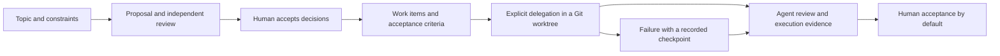
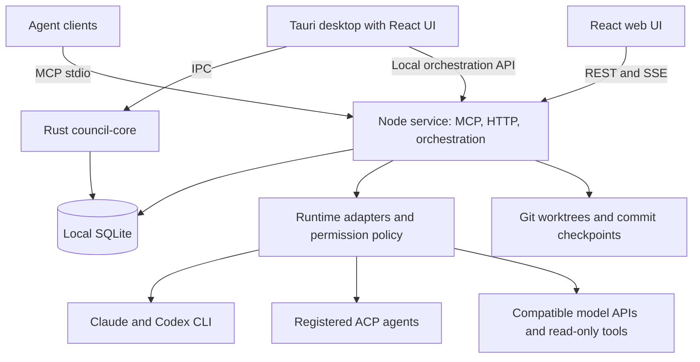

<p align="center"></p>

# Council

**A local workspace where coding agents challenge proposals, record decisions, and deliver work with evidence.**

English · [简体中文](README.zh.md)

Council connects Claude, Codex, and other configured agents around the same project and topic. Move from a proposal to independent review, a human decision, and isolated implementation without manually ferrying messages between chat windows.

The current desktop release is **0.10.0**. The desktop packaging configuration supports macOS Apple Silicon and Intel; the current release has been validated on Apple Silicon. Windows and Linux desktop packages are not provided by the current build configuration.

## Why Council?

Using several capable agents often leaves the coordination work to you:

| The friction | What Council provides |
|---|---|
| Copying one agent's answer into another chat loses context and takes time. | A shared topic with explicit proposals, critiques, rebuttals, and synthesis, accessible through the desktop UI or MCP. |
| Agents agree, but nobody records what was actually accepted. | Proposed decisions remain proposals until a human accepts them; accepted decisions become a traceable decision package. |
| “Done” can mean anything from an idea to a tested change. | Work items have frozen acceptance criteria, execution evidence, and an explicit completion policy. New delegations default to human acceptance. |
| A failed run leaves you unsure what changed or whether retrying is safe. | Isolated Git worktrees, recorded commits, classified failures, and recovery from a verified commit without blindly replaying writes. |
| Pending decisions and blocked tasks disappear across conversations. | **Needs my attention** collects actionable items for the current project and takes you back to the original topic. |

Delegated work retains commits, interrupted correction drafts, and review findings. Review evidence is organized per file, and incomplete evidence blocks approval. Long tasks can continue in bounded segments with saved handoffs and verified file progress. The local worker keeps active tasks running after the desktop closes. See [execution and recovery boundaries](docs/execution-delivery.md).

Long background text cannot displace the current task, constraints, or accepted conclusions. If required material exceeds the context budget, delegation is rejected explicitly. A checkpoint wrapped in prose or Markdown still means unfinished work and cannot become a delivery commit.

Council keeps discussion records on your machine. Model calls still send the selected topic context and permitted code evidence to the provider or CLI you choose. It does not import the private history of your other chat applications.

## The workflow



1. **Frame the question.** Select a project and create a topic with the problem, constraints, and desired outcome.
2. **Get independent review.** Mention an agent in the composer, start a roundtable, or have MCP clients publish their own findings. Roundtables can review a proposal, the workspace, or frozen commits, subject to each runtime's capabilities.
3. **Make the decision.** Accept the chosen decisions yourself. Agreement between models does not grant acceptance. You can also record a human decision without calling a model.
4. **Define the work.** Add work items manually or explicitly ask an agent to generate a plan for an accepted decision. Accepting a decision does not automatically start implementation.
5. **Delegate deliberately.** Choose an executor, a reviewer, permissions, acceptance criteria, and a completion policy. Single-item and sequential batch delegation are supported.
6. **Check the result.** Read the review and recorded evidence. With the default policy, enter your own acceptance evidence before completing the task. Failed or cancelled work with a valid commit can resume in a new worktree, starting with review.

A delegated commit remains in its worktree and branch. Review and integrate it into your project through your normal Git workflow; Council does not automatically merge or deploy it.

## Quick start

### Try the interface without model credentials

Requires **Node.js 24 or newer** and npm.

```bash
git clone https://github.com/GreenJoson/council.git
cd council
npm run install:all
npm run dev:web
```

Open the local address printed by Vite. The default `mock` mode uses sample data; it does not connect to your real project, call models, or persist real work.

### Build the macOS app

Also install a current stable Rust toolchain and Xcode Command Line Tools. The Rust packages declare a minimum of Rust 1.85; use a current toolchain compatible with the locked dependencies.

```bash
npm run dev:desktop
# Or create the application and disk image:
npm run build:desktop
```

Build outputs are under `packages/desktop/src-tauri/target/release/bundle/`. The build downloads a pinned official Node runtime and verifies its SHA-256 before producing the embedded Agent Service. The installed app does not require Node or npm; model CLIs remain separate dependencies.

On first launch:

1. Select a **data library outside the source checkout**. Council creates or opens `council.sqlite3` there.
2. Select the project you want to discuss or implement.
3. Open **Model & Provider settings**. Configure a local CLI or a compatible API provider, then create or enable its agents.
4. For local agents, install and sign in to the corresponding CLI yourself. For remote providers, enter your own API URL, model, and key in settings.
5. Create a topic and use `@Agent` or the roundtable controls to begin.

The app starts and stops its embedded local service. Current local builds use ad-hoc signing; the default build does not provide Apple notarization.

### Run the web UI against real local data

```bash
cp packages/mcp-server/.env.example packages/mcp-server/.env
cp packages/web/.env.example packages/web/.env.local
```

Edit these files before running `npm run dev`:

| Setting | Meaning |
|---|---|
| `COUNCIL_DATA_DIR` | Absolute path to your data library, outside the repository. |
| `COUNCIL_MAX_OUTPUT_CHARS` | Final reply / delivery summary limit; defaults to 30,000 characters in the desktop app. |
| `COUNCIL_CLI_MAX_STREAM_CHARS` | Independent cumulative Claude/Codex CLI event-stream limit, including tool results; defaults to 32,000,000 characters. Increasing it does not increase the final reply limit. |
| `VITE_COUNCIL_DATA_MODE` | Set to `http` for real data. |
| `VITE_COUNCIL_API_URL` | The API's loopback origin; the example backend uses `http://127.0.0.1:4317`. |
| `VITE_COUNCIL_PROJECT_PATH` | Absolute path to the project the agents may inspect. |
| `COUNCIL_HTTP_CORS_ORIGINS_JSON` | The exact web origin printed by Vite, for example `http://localhost:5173`. |

```bash
npm run dev
```

The desktop service and a standalone development API must not both own Model Router writes for the same data library. Stop the desktop service first or use a separate development library and port.

### Connect existing agent clients through MCP

Build the MCP server, then open Settings → Client access and click Write for Claude Code and/or Codex: Council registers itself against the same data library with a distinct caller identity (`claude` or `codex`), installs the Council skill, backs up the original files, and can restore them. See [MCP setup / MCP 接入](docs/mcp-setup.md) for the file locations, drift handling and the manual fallback. The optional [Council skill](skills/council/SKILL.md) supplies the discussion protocol; it is not required for the desktop UI.

Example prompts:

> Create a Council topic for the current project's retry strategy. Inspect the code, publish a proposal, and include failure conditions and a verification plan.

> Read topic `<topic-id>`. Independently challenge the proposal using code evidence, then publish a critique. Keep any decision proposed until I accept it.

An `@codex` invocation starts a local Codex CLI call. It does not control an already-open private Codex App task; the same distinction applies to Claude.

## Architecture



| Module | Responsibility |
|---|---|
| [`packages/web`](packages/web) | React UI (icon rail + conversation stream + context column shell), repository adapters, topic discussion, tasks / assets / pipelines, decisions, and attention views. |
| [`packages/desktop`](packages/desktop) | Tauri shell, native directory selection, local settings, and background worker connection. |
| [`crates/council-core`](crates/council-core) | Rust content reads/writes and validation of the shared SQLite schema. |
| [`packages/mcp-server`](packages/mcp-server) | MCP/HTTP boundaries, the sole schema migrator, provider routing, credentials, runtime adapters, and delegation. |
| [`packages/orchestrator`](packages/orchestrator) | Model-independent run and roundtable state machines, persistence, leases, and cancellation. |
| [`skills/council`](skills/council) | The shared discussion protocol for agent clients. |

**Data and concurrency.** SQLite is the source of truth. Node owns schema migration; Rust waits for service readiness and verifies the same database identity before opening it. Content and orchestration revisions refresh views across processes. Leases and epochs reject stale agent replies; work-item versions reject overwrites of newer human edits.

**Agent, Provider, Runtime.** An Agent is a named participant with its own identity and model configuration. A Provider describes the connection and credential reference. A Runtime implements execution and advertises capabilities. A catalog entry does not imply that its CLI is installed or its capabilities are authorized.

**Discussion and implementation.** Discussion tools are constrained by a read-only policy. Explicit implementation delegation currently uses supported native Claude/Codex CLI executors with the selected permission profile. ACP and compatible API tool loops remain within their declared read-only capabilities. A Git worktree separates changes; it is not an operating-system security boundary.

**Permissions and sign-in.** Agent settings define a permission ceiling; each delegation retains its own execution permission. Continuation keeps the original permission by default and offers an explicit override within the current ceiling. The task card shows the actual permission, and history is preserved. Claude OAuth expiry is reported as an authentication failure; complete `claude auth login` before continuing. Full control does not restore an expired login.

**Recovery and evidence.** Runtime events are stored after redaction. Recovery verifies the repository, managed directory, recorded HEAD, permissions, and task version before creating a new run. A clean delivery commit goes back to review. If execution failed before committing, “Continue unfinished work” copies checked source changes into a new isolated workspace for implementation and review, preserving the original files and history. Missing tool detail is shown as unavailable; context usage is not presented as billing tokens or a calculated cost.

**Long-running tasks.** Delegation shows persisted instruction, implementation, commit, and review stages. Claude has separate configurable turn budgets: 24 for discussion/instructions on desktop, 120 for implementation (`COUNCIL_CLAUDE_EXECUTION_MAX_TURNS`), and 48 for review (`COUNCIL_CLAUDE_REVIEW_MAX_TURNS`). New delegations allow up to four execution segments within a two-hour cumulative window, configurable via `COUNCIL_DELEGATION_MAX_EXECUTION_SEGMENTS` and `COUNCIL_DELEGATION_EXECUTION_TIMEOUT_MS`. A resumable handoff or turn-limit stop with a saved session and verified file progress can continue; quota, permission, authentication, repeated no-progress, and exhausted total budgets pause for inspection. Valid instructions and source changes survive failure; a new workspace uses a fresh model session. Actual tool counts and available turn counts come from structured events, without publishing tool inputs or private session IDs.

## Model discovery and diagnostics

In **Provider & Agent**, save the connection, choose an Agent, and click **Fetch models**. OpenAI-compatible connections query that provider's `/models` endpoint with its saved credential. Unsupported endpoints and CLI/ACP connections keep manual model input; built-in suggestions are not a verified availability list.

**Test** checks the saved Agent. Native Claude/Codex probes check CLI startup, login, and a model reading a random temporary file with read-only permissions. API probes check an actual response; ACP probes currently verify a session handshake. Results show which checks passed, failed, or remain unverified, plus the requested and provider-reported model when available. A reported name is not independent proof of the underlying model. Tests can incur model charges and do not validate project write access or complete a task. Changing configuration invalidates the displayed result; failures never trigger an automatic model or credential switch.

## Project attachments and in-app previews

**Project attachments** in the architecture archive collects local Markdown file links from topics, messages and decisions. Add links such as `[Design](docs/design.xlsx)` or `[Parameters](config/model.json)`. Existing absolute paths inside the project also work. Attachment cards and inline file links open a read-only preview in Council.

- XLSX supports worksheet tabs; CSV/TSV opens as a grid. Formulas use saved values without recalculation.
- Markdown has reading and source views. JSON, YAML, configuration and code open as text. Scripts and HTML are never executed, and document images are not fetched automatically.
- Attachments are **references to current project files**. Topics retain the links; files remain in the project without automatic copying or uploading. These are not versioned backups. Missing files show an error. Uploads, snapshots, PDF/Word and legacy XLS previews are not yet supported.
- Preview reads regular files within the topic's project only. Traversal, escaping symlinks and protected configuration paths such as `.env` or keys are rejected. `COUNCIL_FILE_PREVIEW_*` configures size, grid, expansion and parsing budgets. Truncated previews are labeled and never modify the source.

## Security and current limits

- Supply your own provider credentials. macOS Keychain stores remote API keys; SQLite stores credential references and public settings. No usable API key is included.
- Official API addresses in the provider catalog are editable defaults, not private upstream services. Environment-dependent paths, ports, and runtime settings belong in local configuration.
- The HTTP control plane is **loopback-only and intended for one local user**. It has no per-instance authentication token. Do not expose it through a tunnel, reverse proxy, or public listener.
- Only deliberately published topic content is shared between agent clients. Model calls and authorized code reads still leave the machine through the selected provider; local storage does not mean offline inference.
- New delegations default to human acceptance. Unknown write failures are not automatically replayed; bounded continuation requires a resumable handoff or a turn-limit stop with verified progress. Explicit continuation can retain uncommitted source files in a verified workspace; private configuration, runtime data, binary files, symlinks, and suspected secrets are rejected.
- SQLite audit records are local evidence, not an independently tamper-proof audit service. Native CLI delegations provide stage/commit evidence and observed activity counts; complete tool transcripts are not exposed.
- The local Node worker survives desktop exit and is reused on reconnect. A database-scoped process lock prevents duplicate workers; idle services exit after five minutes by default. Crashes and system restarts still require explicit delegation recovery, and surviving CLI processes block takeover. Finish tasks and stop the old worker before replacing its binary.
- This is a macOS-first, single-user workspace. Multi-user hosting, Windows/Linux desktop releases, cost accounting, automatic ADR export, and automatic merging/deployment are not current release promises.

See [Security / 安全说明](SECURITY.md), [execution and recovery](docs/execution-delivery.md) (Chinese), and [schema migration safety](docs/schema-migration-safety.md) (Chinese).

## Development and verification

```bash
npm run check       # TypeScript, Rust formatting, Clippy
npm test            # Unit and integration tests, including Rust
npm run test:e2e    # Real HTTP/SSE and browser flows with test agents
npm run audit       # npm dependency advisories
```

E2E requires Python 3, the Python Playwright package, and its Chromium browser. It uses temporary databases and fake agents, so a passing E2E run is not proof of live provider compatibility or model quality. See the [0.10.0 release review](docs/release-0.10.0.md).

For contributions, describe the user-visible problem, keep changes within the owning module, run the relevant checks, and update both language READMEs plus the affected directory's `_README.md`. Never include local databases, `.env` files, credentials, or private project captures in a contribution. Detailed Chinese usage is available in the [user guide](docs/usage.md).

## Changelog

Release review records live in `docs/` (Chinese). Versions before 0.9.2 are only in the git history.

### Unreleased

- Desktop: the webview CSP now allows `img-src` from the loopback Agent Service, so asset thumbnails, full-size images and message images render inside the installed app instead of a broken placeholder (0.10.0 had only verified the image endpoints over HTTP).
- Desktop: the "Agent Service not ready" banner only quotes a sidecar log error written during the current launch, and only once the sidecar has exited; errors from earlier sessions are no longer presented as the reason.
- Image generation no longer requires the project to be a Git repository: image delegations and the pipeline image stage now run in an isolated empty directory under the delegation root, with no worktree, so uncommitted changes don't block them either. Code delegations, including the prototype stage, still need Git; on a non-repository they now say to initialise and make a first commit instead of a generic "Git operation failed".
- Image viewer: a long Lightbox title (such as an image prompt) no longer stretches the frame, so the full image is centred instead of half of it being cut off; the title is truncated to one line with the full text on hover.
- Asset library layout: the grid fills the available width with 4:3 cards; the detail page is now two columns — a large original-resolution preview on the left that scales with the window height and stays pinned while scrolling (click to open full size), metadata on the right — falling back to one column on narrow screens.
- Image viewer: previous/next arrows on both sides of the Lightbox (also ← / →) with a "3 / 12" position, in library order from the asset detail page and within the set on a task's outputs and the pipeline's image comparison; zoom resets on each page turn and trackpad pinch now zooms too. Closing the viewer on the asset detail page moves the page to the last image you looked at.
- Asset detail: step to the previous/next asset without going back to the grid — arrows on both sides of the large preview, a "‹ 3 / 12 ›" pager in the header, or ← / → (when the full-size viewer is closed); the order matches the library grid.
- Pipelines and tasks: in-section search and folding. A task's brief, a pipeline parent task and the pipeline's review history each get a search box in the section header that filters entries and highlights hits; long lists, long goals, long task bodies and long raw fields are folded with "Show N more". Review rounds collapse individually (only the latest is open). A pipeline parent task's brief (the pipeline document) is collapsed by default, links to the pipeline and is no longer editable there, since editing would replace the document with a council-brief.
- Pipeline track: when a revision round of image generation fails after earlier rounds already produced images, the image stage says so — the earlier images are kept and Resume only reruns that revision round. Stage links show the child task's title.
- Pipelines: once a review sends images back and the next revision round starts, the superseded image child task is marked completed (its images stay in the library and can still be picked as finals). Previously it stayed "in progress" forever because image tasks wait for human sign-off, so the parent kept showing in progress even when the revision round had failed. Startup reconciliation repairs pipelines created before this fix.
- Image generation: the default `COUNCIL_CODEX_IMAGE_TIMEOUT_MS` is now 30 minutes (was 15). A revision round redrawing 6 images was killed at 15 minutes while still making progress and all of its output was discarded; the image prompt now also tells Codex to generate each image once and redo it at most once, only when it clearly misses the spec.
- Image generation: one stuck generator call no longer sinks the whole round. Previously a single call hung for 11 minutes while Codex kept waiting, the round was killed at 30 minutes, and the 5 images already finished were discarded; the prompt now tells Codex to abort a call with no result after 4 minutes and retry once, and if it hangs again to skip that image, deliver the rest and say so in the notes. When a pipeline review finds a deliverable with no output this round, the round is recorded as "Needs revision" and the next revision round produces it (if revisions are used up it goes to selection as before); the review record header shows "N not produced" and lists the missing deliverables when expanded.

### 0.10.0 — 2026-10-11

- The V2 refactor is merged in full: direct code tasks, an asset library with Codex image generation, multi-stage pipelines (brief → images → review → prototype), and a consolidated UI.
- Worker teams: a code task can be handed to a Lead that splits it across parallel Workers. Each Worker runs in its own worktree and branch, is merged back under control, and the whole team is reviewed once.
- Client onboarding: one click registers the Council MCP server and Skill into the local Claude Code / Codex configuration, touching only Council's own entries, with drift detection and restore.
- Message image attachments: paste or reference images from the editor. They are stored in the log library's asset store, not in the project tree, and rendered inline through `council-asset:` references.
- New app icon: three seats, three arcs and a consensus star on a light plate, sharing one geometry with the in-app `BrandLogo` and the favicon.
- Schema v19 → v20 is a breaking migration. Older binaries cannot open a migrated library; the migrator writes a pre-migration backup next to it.
- Review record: [0.10.0 release review](docs/release-0.10.0.md).

### 0.9.3 – 0.9.8 — 2026-09-21

- Delegation hardening: CLI execution streams separated from reply limits, unfinished delegated code continued in isolated workspaces, delegation progress persisted with separate execution budgets, explicit continuation permissions preserved, delegation history aligned, staged delivery preserved and complete review evidence required.

### 0.9.2 — 2026-09-20

- Decision packs, multi-agent delegation, task acceptance, execution evidence, per-project pending items and recovery from commit checkpoints; first official desktop icon; dependency security updates. Schema v16.
- Review record: [0.9.2 release review](docs/release-0.9.2.md).

## License

[MIT](LICENSE). Third-party dependencies and brand assets retain their own licenses and trademark rights; provider marks identify integrations and do not imply endorsement. Asset provenance is recorded in the [provider catalog](packages/mcp-server/resources/provider-catalog.json). The desktop build includes Node and bundled dependency notices.
